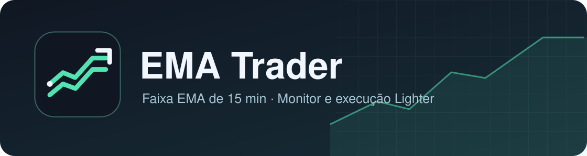

<p align="center"></p>

<p align="center"><a href="README.md">Português</a> · <a href="README.en.md">English</a> · <a href="README.es.md">Español</a></p>

Monitor and optionally trade Lighter perpetuals using a 15-minute Heikin Ashi EMA band.

- **[Download](https://github.com/ramonck/EMATrader/releases/latest)** — Releases include desktop and CLI packages for Windows and macOS, and CLI packages for Linux.
- **[Get started](knowledge/en/ORDERS.md)** — In the desktop app, use **Settings → Language and MCP**. The CLI accepts `--lang pt|en|es`. Enabling automation automatically adopts the selected asset's existing position.
- **[Connect via MCP](knowledge/en/MCP.md)** — Local MCP lets you inspect the running instance, including positions, P&L, signals and rules.
- **[Knowledge base](knowledge/en/index.md)** — The index points to short topics a new chat can read independently of prior conversation.

To build and publish a version, open **Actions → Compilar EMA Trader → Run workflow**. The Action creates the tag and publishes a Release with all five packages. [GitHub Actions](knowledge/en/RELEASE.md)

## Run from source

```sh
python -m pip install -r requirements.txt
python app.py --lang en --symbol BTC
python app.py --lang en --gui
python app.py --lang en --subaccounts
python -m unittest -v
```

## Six-month backtest

BTC/USDT on Binance Spot, 2026-05-24 to 2026-11-24, starting and ending at 03:00 UTC. 15-minute EMA band, 1× exposure and compounded equity. Both runs use the same local candle file.

| Cost per side | Net ROI | Max drawdown | Closed trades | Winning trades |
| --- | ---: | ---: | ---: | ---: |
| 0.01% | **+26.63%** | 18.35% | 320 | 103 |
| 0.05% | **−2.03%** | 27.51% | 320 | 96 |

ROI includes the ending open short marked at the last close. Compare the cost assumptions when interpreting the results. [Reproduce the backtest and check assumptions](knowledge/en/BACKTEST.md)

## Connect to local MCP

In EMA Trader, open **Settings → Language and MCP**, enable MCP and copy the token. The default port is `8765`. For CLI set `EMA_TRADER_MCP_TOKEN` to a random alphanumeric token of at least 24 characters before running `python app.py --mcp-port 8765`.

In Codex, add this block to your local `~/.codex/config.toml` and restart the client. Replace `YOUR_TOKEN` with the copied token. Keep the file outside the repository.

```toml
[mcp_servers.ema_trader]
url = "http://127.0.0.1:8765/mcp"
http_headers = { Authorization = "Bearer YOUR_TOKEN" }
```

In Claude Code, register the URL and the same token:

```sh
claude mcp add --transport http ema-trader http://127.0.0.1:8765/mcp --header "Authorization: Bearer YOUR_TOKEN"
```

With the app running, ask “What is the current position and latest signal?” MCP is opt-in and read-only. For rules, request `knowledge_index` in `en` and then only the relevant topic. [MCP](knowledge/en/MCP.md)
