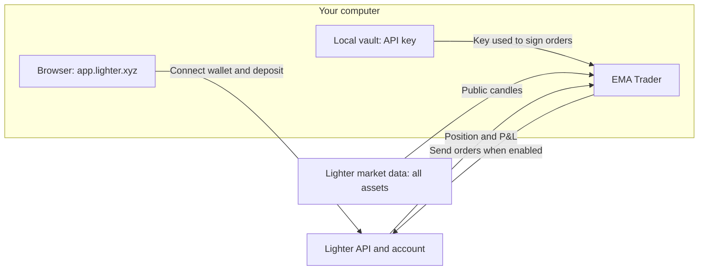

<p align="center"></p>

<p align="center"><a href="README.md">Português</a> · <a href="README.en.md">English</a> · <a href="README.es.md">Español</a></p>

Monitor and optionally trade Lighter perpetuals using a 15-minute Heikin Ashi EMA band.

**Educational use.** This project provides no financial advice or recommendations about assets, platforms, or trades. When using real funds, continuously monitor the bot, orders, and positions. If something goes wrong, disable automation if possible and manage or close the position in the [official Lighter interface](https://app.lighter.xyz/). [Use and risk notice](DISCLAIMER.md#english)

## Why EMA Trader?

Elon Musk argues that advances in AI and robotics could make money irrelevant.

> There will still be constraints on power like electricity and mass. But I think at some point currency becomes irrelevant.
>
> — Elon Musk. [Business Insider](https://www.businessinsider.com/elon-musk-robotics-money-irrelevant-currency-universal-basic-income-2025-11)

EMA Trader applies automation to market monitoring and strategy execution with explicit rules.

- **[Download](https://github.com/ramonck/EMATrader/releases/latest)** — Releases include desktop and CLI packages for Windows and macOS, and CLI packages for Linux.
- **[Get started](knowledge/en/ORDERS.md)** — In the desktop app, use **Settings → Language and MCP**. The CLI accepts `--lang pt|en|es`. Enabling automation automatically adopts the selected asset's existing position.
- **[Connect via MCP](knowledge/en/MCP.md)** — Local MCP lets you inspect the running instance, including positions, P&L, signals and rules.
- **[Knowledge base](knowledge/en/index.md)** — The index points to short topics a new chat can read independently of prior conversation.

To build and publish a version, open **Actions → Compilar EMA Trader → Run workflow**. The Action creates the tag and publishes a Release with all five packages. [GitHub Actions](knowledge/en/RELEASE.md)

**Find an asset.** Type `BTC` or `NVDA` into **Find asset**. The list filters the Lighter catalog’s symbols. Press **Enter** to select the first result.


## Getting started with Lighter

Lighter is a protocol for trading perpetual futures in the Ethereum ecosystem. A perpetual tracks an asset price, such as BTC, without an expiry date. EMA Trader uses Lighter’s API to read account data and execute orders. Fees, spread and funding affect trading costs. Leveraged positions can be liquidated. [Lighter FAQ](https://lighter.xyz/faq) · [Official fee schedule](https://docs.lighter.xyz/trading/trading-fees)

Use the browser to connect your wallet and deposit. EMA Trader runs on your computer, calculates the EMA band and talks to the **Lighter API**. Its API key stays in the local vault. You can monitor the account before enabling orders.



If Lighter is available to you, open **Deposit** before buying USDC. Note the asset, source network and minimum shown. Use the matching deposit route and check that the intended account receives the credit.

**Coinbase.** The guide covers ACH and how to send USDC to an eligible wallet or destination. Coinbase funding does not change the Lighter terms, which restrict its interface and API for U.S. residents and people located in the U.S. [Coinbase ACH](https://help.coinbase.com/en/exchange/funding/depositing-with-ach) · [Sending from Coinbase](https://help.coinbase.com/en-gb/coinbase/trading-and-funding/cryptocurrency-trading-pairs/steps-to-send-crypto) · [Lighter terms](https://lighter.xyz/terms)

[Full deposit and setup guide](knowledge/en/LIGHTER.md)

## Support the project

Enjoy EMA Trader and want to support the project? Send **native USDC** on **Arbitrum One** to this address:

```text
0x0FcbBFe9F4E39816799857E35887876B1d869929
```

Check the network and token in your wallet before sending.

## Security and verification

The local vault encrypts the Lighter key, account profile and private trading history. Open **Settings → Orders → Unlock vault**. Releases provide build attestations and SHA256 digests. [Vault and migration](knowledge/en/DATA.md) · [Verify a download](knowledge/en/RELEASE.md)


## Run from source

```sh
python -m pip install -r requirements.txt
python app.py --lang en --symbol BTC
python app.py --lang en --gui
python app.py --lang en --subaccounts
python -m unittest -v
```

## BTC backtest · six months

This historical simulation uses Binance Spot data. The running monitor uses Lighter candles, including for BTC.

BTC/USDT on Binance Spot, 2026-05-24 to 2026-11-24 at 03:00 UTC. 15-minute EMA band with **$100 starting equity and base margin**. After a win, the next margin includes the realized profit. After a loss, the target resets to $100. Each entry is capped at available equity, with no top-ups.

| Cost per side | Leverage | Ending equity | Account ROI | Max drawdown | Closed trades |
| --- | ---: | ---: | ---: | ---: | ---: |
| 0.01% | 1× | $127.00 | +27.00% | 17.88% | 320 |
| 0.01% | 10× | $77.63 | −22.37% | 25.19% | 6 |
| 0.05% | 1× | $82.82 | −17.18% | 25.05% | 284 |
| 0.05% | 10× | $77.19 | −22.81% | 25.05% | 4 |

The simulation uses a 25% drawdown trigger from peak equity. When a 15-minute close reaches it, the next bar opens with a position exit and trading halts. Drawdown can exceed the trigger before the exit. See [assumptions and commands](knowledge/en/BACKTEST.md) for unprotected and per-trade stop results.

## Connect to local MCP

In EMA Trader, open **Settings → Language and MCP**, enable MCP and copy the token. The default port is `8765`. For CLI set `EMA_TRADER_MCP_TOKEN` to a random alphanumeric token of at least 24 characters before running `python app.py --mcp-port 8765`.

In Codex, add this block to your local `~/.codex/config.toml` and restart the client. Replace `YOUR_TOKEN` with the copied token. Keep the file outside the repository.

```toml
[mcp_servers.ema_trader]
url = "http://127.0.0.1:8765/mcp"
http_headers = { Authorization = "Bearer YOUR_TOKEN" }
```

In Claude Code, register the URL and the same token:

```sh
claude mcp add --transport http ema-trader http://127.0.0.1:8765/mcp --header "Authorization: Bearer YOUR_TOKEN"
```

With the app running, ask “What is the current position and latest signal?” MCP is opt-in and read-only. For rules, request `knowledge_index` in `en` and then only the relevant topic. [MCP](knowledge/en/MCP.md)
