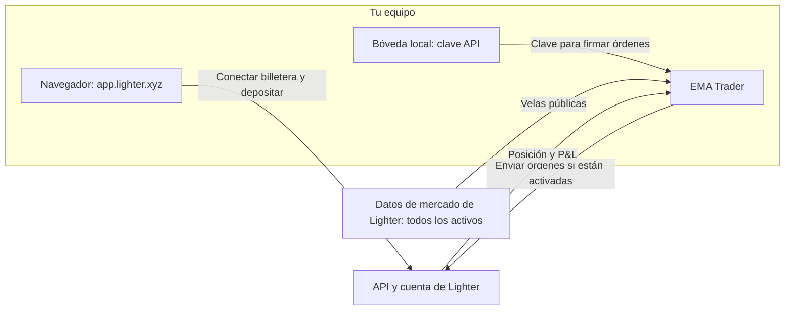

<p align="center"></p>

<p align="center"><a href="README.md">Português</a> · <a href="README.en.md">English</a> · <a href="README.es.md">Español</a></p>

Monitor y ejecución opcional de perpetuos en Lighter con una banda EMA Heikin Ashi de 15 minutos.

**Uso educativo.** Este proyecto no brinda asesoramiento financiero ni recomienda activos, plataformas u operaciones. Si usas dinero real, supervisa continuamente el robot, las órdenes y las posiciones. Si algo falla, desactiva la automatización si es posible y gestiona o cierra la posición en la [interfaz oficial de Lighter](https://app.lighter.xyz/). [Aviso de uso y riesgos](DISCLAIMER.md#español)

## ¿Por qué EMA Trader?

Elon Musk cree que la IA y la robótica pueden hacer que el dinero pierda su relevancia.

> Seguirá habiendo limitaciones de energía, como la electricidad, y de masa. Pero creo que, en algún momento, la moneda se vuelve irrelevante.
>
> — Elon Musk, en traducción libre. [Business Insider](https://www.businessinsider.com/elon-musk-robotics-money-irrelevant-currency-universal-basic-income-2025-11)

EMA Trader aplica la automatización al seguimiento del mercado y a la ejecución de estrategias con reglas explícitas.

- **[Descargar](https://github.com/ramonck/EMATrader/releases/latest)** — Las versiones incluyen ventana y terminal para Windows y macOS, y terminal para Linux.
- **[Empezar](knowledge/es/ORDERS.md)** — En la ventana usa **Configuración → Idioma y MCP**. La terminal acepta `--lang pt|en|es`. Al activar la automatización, la aplicación asume la posición existente del activo seleccionado.
- **[Conectar por MCP](knowledge/es/MCP.md)** — MCP local permite consultar la instancia en marcha, incluidas posiciones, P&L, señales y reglas.
- **[Base de conocimiento](knowledge/es/index.md)** — El índice enlaza temas breves que un chat nuevo puede consultar sin depender de la conversación anterior.

Para compilar y publicar una versión, abre **Actions → Compilar EMA Trader → Run workflow**. La acción crea la etiqueta y publica una Release con los cinco paquetes. [GitHub Actions](knowledge/es/RELEASE.md)

**Buscar un activo.** Escribe `BTC` o `NVDA` en **Buscar activo**. La lista filtra los códigos del catálogo de Lighter. Pulsa **Enter** para seleccionar el primer resultado.


## Primeros pasos con Lighter

Lighter es un protocolo para operar contratos perpetuos en el ecosistema Ethereum. Un perpetuo sigue el precio de un activo, como BTC, sin fecha de vencimiento. EMA Trader usa la API de Lighter para consultar la cuenta y ejecutar órdenes. Las comisiones, el spread y la financiación afectan al resultado. Una posición apalancada puede liquidarse. [Preguntas frecuentes de Lighter](https://lighter.xyz/faq) · [Tarifas oficiales](https://docs.lighter.xyz/trading/trading-fees)

El navegador sirve para conectar la billetera y depositar. EMA Trader funciona en tu equipo, calcula la banda EMA y se comunica con la **API de Lighter**. La clave de API queda en la bóveda local. Puedes seguir la cuenta antes de activar órdenes.



Abre **Depositar** antes de comprar USDC. Revisa el activo, la red de origen y el importe mínimo que indica la pantalla. Usa la ruta compatible y comprueba que se acredite la cuenta correcta.

**Países hispanohablantes.** Coinbase es una alternativa donde tu cuenta permita comprar y enviar USDC. Consulta los métodos disponibles en tu país. La guía también incluye ejemplos de SPEI en México, CVU en Argentina y Bancolombia en Colombia. [Envíos desde Coinbase](https://help.coinbase.com/es-es/coinbase/trading-and-funding/cryptocurrency-trading-pairs/steps-to-send-crypto)

[Guía completa de depósito y configuración](knowledge/es/LIGHTER.md)

## Apoya el proyecto

¿Te gusta EMA Trader y quieres apoyar el proyecto? Envía **USDC nativo** por la red **Arbitrum One** a esta dirección:

```text
0x0FcbBFe9F4E39816799857E35887876B1d869929
```

Comprueba la red y el token en tu billetera antes de enviar.

## Seguridad y verificación

La bóveda local cifra la clave de Lighter, el perfil de cuenta y el historial privado. Abre **Configuración → Órdenes → Desbloquear bóveda**. Las Releases incluyen atestaciones de procedencia y SHA256. [Bóveda y migración](knowledge/es/DATA.md) · [Verificar una descarga](knowledge/es/RELEASE.md)


## Ejecutar desde el código

```sh
python -m pip install -r requirements.txt
python app.py --lang es --symbol BTC
python app.py --lang es --gui
python app.py --lang es --subaccounts
python -m unittest -v
```

## Backtest de BTC · seis meses

Esta simulación histórica usa datos de Binance Spot. El monitor en ejecución usa velas de Lighter, incluido BTC.

BTC/USDT en Binance Spot, del 24/05/2026 al 24/11/2026 a las 03:00 UTC. Banda EMA de 15 minutos con **US$ 100 de saldo inicial y margen base**. Tras una ganancia, el siguiente margen incorpora el beneficio realizado. Tras una pérdida, el objetivo vuelve a US$ 100. Cada entrada se limita al saldo disponible, sin aportes.

| Coste por lado | Apalancamiento | Saldo final | ROI de la cuenta | Caída máxima | Operaciones cerradas |
| --- | ---: | ---: | ---: | ---: | ---: |
| 0,01% | 1× | US$ 127,00 | +27,00% | 17,88% | 320 |
| 0,01% | 10× | US$ 77,63 | −22,37% | 25,19% | 6 |
| 0,05% | 1× | US$ 82,82 | −17,18% | 25,05% | 284 |
| 0,05% | 10× | US$ 77,19 | −22,81% | 25,05% | 4 |

La simulación usa un límite del 25% desde el máximo del saldo. Si se alcanza al cierre de 15 minutos, cierra en la siguiente apertura y bloquea nuevas entradas. La caída puede superar el límite antes de la salida. Consulta [supuestos y comandos](knowledge/es/BACKTEST.md) para ver las variantes sin protección y con stop individual.

## Conectar a MCP local

En EMA Trader abre **Configuración → Idioma y MCP**, activa MCP y copia el token. El puerto predeterminado es `8765`. Para la terminal define `EMA_TRADER_MCP_TOKEN` con un token aleatorio alfanumérico de al menos 24 caracteres antes de ejecutar `python app.py --mcp-port 8765`.

En Codex agrega este bloque a tu `~/.codex/config.toml` local y reinicia el cliente. Sustituye `TU_TOKEN` por el token copiado. Guarda el archivo fuera del repositorio.

```toml
[mcp_servers.ema_trader]
url = "http://127.0.0.1:8765/mcp"
http_headers = { Authorization = "Bearer TU_TOKEN" }
```

En Claude Code registra la URL y el mismo token:

```sh
claude mcp add --transport http ema-trader http://127.0.0.1:8765/mcp --header "Authorization: Bearer TU_TOKEN"
```

Con la aplicación abierta, pregunta «¿Cuál es la posición y la última señal?». MCP es opcional y de solo lectura. Para reglas, pide `knowledge_index` en `es` y luego solo el tema pertinente. [MCP](knowledge/es/MCP.md)
