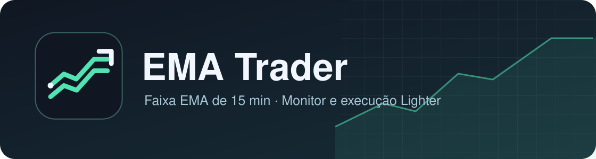

<p align="center"></p>

<p align="center"><a href="README.md">Português</a> · <a href="README.en.md">English</a> · <a href="README.es.md">Español</a></p>

Monitor y ejecución opcional de perpetuos en Lighter con una banda EMA Heikin Ashi de 15 minutos.

## ¿Por qué EMA Trader?

Elon Musk cree que la IA y la robótica pueden hacer que el dinero pierda su relevancia.

> Seguirá habiendo limitaciones de energía, como la electricidad, y de masa. Pero creo que, en algún momento, la moneda se vuelve irrelevante.
>
> — Elon Musk, en traducción libre. [Business Insider](https://www.businessinsider.com/elon-musk-robotics-money-irrelevant-currency-universal-basic-income-2025-11)

EMA Trader aplica la automatización al seguimiento del mercado y a la ejecución de estrategias con reglas explícitas.

- **[Descargar](https://github.com/ramonck/EMATrader/releases/latest)** — Las versiones incluyen ventana y terminal para Windows y macOS, y terminal para Linux.
- **[Empezar](knowledge/es/ORDERS.md)** — En la ventana usa **Configuración → Idioma y MCP**. La terminal acepta `--lang pt|en|es`. Al activar la automatización, la aplicación asume la posición existente del activo seleccionado.
- **[Conectar por MCP](knowledge/es/MCP.md)** — MCP local permite consultar la instancia en marcha, incluidas posiciones, P&L, señales y reglas.
- **[Base de conocimiento](knowledge/es/index.md)** — El índice enlaza temas breves que un chat nuevo puede consultar sin depender de la conversación anterior.

Para compilar y publicar una versión, abre **Actions → Compilar EMA Trader → Run workflow**. La acción crea la etiqueta y publica una Release con los cinco paquetes. [GitHub Actions](knowledge/es/RELEASE.md)

## Ejecutar desde el código

```sh
python -m pip install -r requirements.txt
python app.py --lang es --symbol BTC
python app.py --lang es --gui
python app.py --lang es --subaccounts
python -m unittest -v
```

## Backtest de BTC · seis meses

BTC/USDT en Binance Spot, del 24/05/2026 al 24/11/2026 a las 03:00 UTC. Banda EMA de 15 minutos con **US$ 100 de margen por operación a 10×** (US$ 1.000 de exposición inicial), sin reinvertir las ganancias.

| Coste por lado | P&L de operaciones cerradas | Short abierto al final | P&L total | ROI promedio por operación cerrada |
| --- | ---: | ---: | ---: | ---: |
| 0,01% | +US$ 265,35 | +US$ 20,25 | **+US$ 285,60** | +0,83% |
| 0,05% | +US$ 9,42 | +US$ 19,46 | **+US$ 28,88** | +0,03% |

Se cerraron **320 operaciones**. Con un coste de 0,01% por lado, la mejor operación rindió **US$ 197,92**, hubo 103 operaciones ganadoras y la mayor caída entre cierres de vela fue de **US$ 198,58**. El ROI promedio usa el margen por orden. Para calcular el ROI de la cuenta, hacen falta el saldo inicial y la reserva para financiar la estrategia. [Supuestos, comparación a 1× y comandos para reproducir](knowledge/es/BACKTEST.md)

## Conectar a MCP local

En EMA Trader abre **Configuración → Idioma y MCP**, activa MCP y copia el token. El puerto predeterminado es `8765`. Para la terminal define `EMA_TRADER_MCP_TOKEN` con un token aleatorio alfanumérico de al menos 24 caracteres antes de ejecutar `python app.py --mcp-port 8765`.

En Codex agrega este bloque a tu `~/.codex/config.toml` local y reinicia el cliente. Sustituye `TU_TOKEN` por el token copiado. Guarda el archivo fuera del repositorio.

```toml
[mcp_servers.ema_trader]
url = "http://127.0.0.1:8765/mcp"
http_headers = { Authorization = "Bearer TU_TOKEN" }
```

En Claude Code registra la URL y el mismo token:

```sh
claude mcp add --transport http ema-trader http://127.0.0.1:8765/mcp --header "Authorization: Bearer TU_TOKEN"
```

Con la aplicación abierta, pregunta «¿Cuál es la posición y la última señal?». MCP es opcional y de solo lectura. Para reglas, pide `knowledge_index` en `es` y luego solo el tema pertinente. [MCP](knowledge/es/MCP.md)
