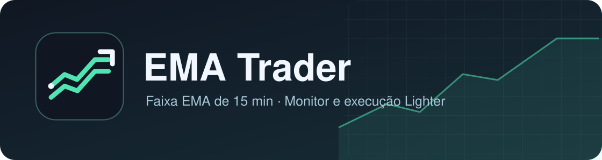
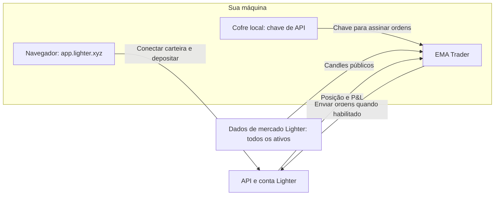

<p align="center"></p>

<p align="center"><a href="README.md">Português</a> · <a href="README.en.md">English</a> · <a href="README.es.md">Español</a></p>

Monitor de perpétuos com faixa EMA Heikin Ashi de 15 minutos. Os dados de mercado e as ordens do EMA Trader usam exclusivamente a Lighter.

**Uso educacional.** Este projeto não oferece aconselhamento financeiro nem recomenda ativos, plataformas ou operações. Ao usar dinheiro real, acompanhe continuamente o robô, as ordens e as posições. Em caso de falha, desative a automação, se possível, e gerencie ou encerre a posição pela [interface oficial da Lighter](https://app.lighter.xyz/). [Aviso de uso e riscos](DISCLAIMER.md#português)

## Por que o EMA Trader?

Elon Musk acredita que a IA e a robótica podem tornar o dinheiro irrelevante.

> Ainda haverá limitações de energia, como a eletricidade, e de massa. Mas acho que, em algum momento, a moeda se torna irrelevante.
>
> — Elon Musk, em tradução livre. [Business Insider](https://www.businessinsider.com/elon-musk-robotics-money-irrelevant-currency-universal-basic-income-2025-11)

O EMA Trader aplica a automação ao monitoramento de mercado e à execução de estratégias com regras explícitas.

- **[Baixar](https://github.com/ramonck/EMATrader/releases/latest)** — A Release inclui Windows e macOS com janela e terminal, e Linux com terminal.
- **[Site do projeto](https://ramonck.github.io/EMATrader/)** — Apresentação, gráfico ilustrativo animado e backtest da Lighter.
- **[Começar](knowledge/pt/ORDERS.md)** — Na janela use **Configurações → Idioma e MCP** para trocar o idioma. O terminal aceita `--lang pt|en|es`. Ao habilitar a automação, o app assume automaticamente a posição existente do ativo selecionado.
- **[Conectar por MCP](knowledge/pt/MCP.md)** — O MCP local permite consultar a instância em andamento, inclusive posição, P&L, sinal e regras.
- **[Base de conhecimento](knowledge/pt/index.md)** — O índice aponta para tópicos curtos que um novo chat pode consultar sem depender da conversa anterior.

Para gerar e publicar uma versão, abra **Actions → Compilar EMA Trader → Run workflow**. O próprio Action cria a tag e publica a Release com os cinco pacotes. [GitHub Actions](knowledge/pt/RELEASE.md)

**Busca de ativos.** Digite `BTC` ou `NVDA` no campo **Buscar ativo**. A lista filtra os códigos do catálogo da Lighter. Pressione **Enter** para selecionar o primeiro resultado.


## Primeiros passos com a Lighter

A Lighter é um protocolo de negociação de contratos perpétuos no ecossistema Ethereum. Um perpétuo acompanha o preço de um ativo, como BTC, sem data de vencimento. O EMA Trader usa a Lighter porque ela oferece uma API para consultar a conta e executar ordens. Taxas, spread e funding podem afetar o resultado. Com alavancagem, uma posição pode ser liquidada. [FAQ da Lighter](https://lighter.xyz/faq) · [Tabela oficial de taxas](https://docs.lighter.xyz/trading/trading-fees)

O navegador serve para conectar a carteira e depositar. O robô roda no seu computador, calcula a faixa EMA e fala com a **API da Lighter**. A chave da API fica no cofre local. Você pode acompanhar a conta antes de habilitar ordens.



Abra **Depositar** na Lighter antes de comprar USDC. Anote o token, a rede de origem e o valor mínimo que a tela mostra. Depois use a rota compatível para depositar e confira se o saldo apareceu na conta certa.

**Brasil.** Coinbase Brasil, Binance Brasil e OKX Brasil documentam depósito de reais por Pix. Depois de comprar USDC, confira a rede e o envio na corretora antes de iniciar o depósito na Lighter. A CriptoCore documenta pagamentos em reais por Pix a partir de saldo cripto. [Coinbase Brasil](https://help.coinbase.com/pt-br/coinbase/getting-started/add-a-payment-method/add-and-verify-pm-namerica-latam) · [Binance Brasil](https://www.binance.com/pt-BR/support/faq/detail/53636607eebc42dbb513863b49bba98f) · [OKX Brasil](https://www.okx.com/pt-br/help/how-do-i-deposit-brl) · [CriptoCore](https://criptocore.net/)

[Guia completo de depósito e configuração](knowledge/pt/LIGHTER.md)

## Apoie o projeto

Gostou do EMA Trader e quer apoiar o projeto? Envie **USDC nativo** pela rede **Arbitrum One** para este endereço:

```text
0x0FcbBFe9F4E39816799857E35887876B1d869929
```

Confira a rede e o token na sua carteira antes de enviar.

## Segurança e verificação

O cofre local criptografa a chave da Lighter, o perfil da conta e o histórico privado. Abra **Configurações → Ordens → Desbloquear cofre**. As Releases trazem atestações de procedência e SHA256 dos pacotes. [Cofre e migração](knowledge/pt/DATA.md) · [Verificar download](knowledge/pt/RELEASE.md)


## Rodar a partir do código

```sh
python -m pip install -r requirements.txt
python app.py --lang pt --symbol BTC
python app.py --lang pt --gui
python app.py --lang pt --subaccounts
python -m unittest -v
```

## Backtest de BTC perpétuo na Lighter · seis meses

**ROI simulado de +454,91%**, com 163 operações fechadas e queda máxima de 82,04% nos fechamentos de 15 min. O backtest usa exclusivamente candles do BTC perpétuo da Lighter Mainnet, de 24/05 a 24/11/2026 às 00h de Brasília, com a regra de produção da v0.1.14.

Premissas de US$ 100 de saldo inicial e margem base, 10× de alavancagem, reinvestimento e custo fixo simulado de 0,05% por lado. O cenário deixa a trava de perda desativada. O modelo usa preços de abertura de candle para execução e deixa funding, slippage e liquidação fora do cálculo. [Premissas e reprodução](knowledge/pt/BACKTEST.md)

## Conectar o MCP local

No EMA Trader, abra **Configurações → Idioma e MCP**, ative o MCP e copie o token. A porta padrão é `8765`. No terminal, defina `EMA_TRADER_MCP_TOKEN` com um token aleatório alfanumérico de pelo menos 24 caracteres antes de rodar `python app.py --mcp-port 8765`.

No Codex, adicione este bloco ao seu `~/.codex/config.toml` local e reinicie o cliente. Substitua `SEU_TOKEN` pelo token copiado. Guarde o arquivo fora do repositório.

```toml
[mcp_servers.ema_trader]
url = "http://127.0.0.1:8765/mcp"
http_headers = { Authorization = "Bearer SEU_TOKEN" }
```

No Claude Code, registre a URL e o mesmo token:

```sh
claude mcp add --transport http ema-trader http://127.0.0.1:8765/mcp --header "Authorization: Bearer SEU_TOKEN"
```

Com o app aberto, pergunte “Qual é a posição e o último sinal?” O MCP é opcional e só leitura. Para regras, peça o `knowledge_index` em `pt` e depois apenas o tópico necessário. [MCP](knowledge/pt/MCP.md)
